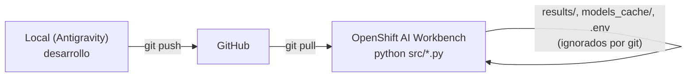

# Benchmark de Embeddings (CPU) y Chunking — Payworks RAG sobre OpenShift AI + pgvector

Benchmark científico de **5 modelos de embeddings viables en CPU × 3 perfiles de chunking** (15 experimentos) sobre la documentación técnica financiera de **Payworks** en español. Usa **PostgreSQL + `pgvector`** como almacén vectorial y **Red Hat OpenShift AI** como entorno de ejecución.

---

## 1. Flujo de trabajo (Git Sync unidireccional)



1. Todo el código se desarrolla en local y se sube con `git push`.
2. En el Workbench **solo** se ejecuta `git pull` y los scripts por CLI. Sin notebooks.
3. Ningún artefacto generado (cachés, pesos HF, logs, `results/`, `.env`, `.venv/`) se versiona → `git status` queda limpio tras cada corrida. Además, todos los scripts desactivan la escritura de `__pycache__`.

---

## 2. Estructura

```text
.
├── .gitignore                 # Blindado para el Workbench
├── .env.example               # Plantilla de variables (PG, INFERENCE_MODE, endpoints, HF_HOME)
├── requirements.txt           # Dependencias fijadas (torch CPU-only)
├── docs/
│   ├── Payworks_Master_RAG.md # Documento fuente (hoy: PLANTILLA ilustrativa → reemplazar)
│   └── golden_dataset.json    # 15 preguntas + ground truth editable
├── sql/init_pgvector.sql      # DDL: extensión, 3 tablas por dimensión, HNSW + B-Tree
└── src/
    ├── config.py              # .env, MODELOS_CONFIG, CHUNK_PERFILES, utilidades
    ├── chunker.py             # Chunking híbrido 2 etapas + contexto jerárquico (CLI de inspección)
    ├── embeddings_client.py   # local_cpu (SentenceTransformers) | openai_endpoint (HTTP + MRL/L2)
    ├── db_setup.py            # Aplica el DDL y verifica
    ├── ingest.py              # Chunk → embed → pgvector (idempotente, con tiempos)
    └── evaluate.py            # Golden Dataset → métricas → CSV + reporte Markdown
```

---

## 3. Matriz experimental

| ID corto | Hugging Face ID | Dim | Tabla | Prefijo doc | Prefijo query | Ventana |
| :--- | :--- | :---: | :--- | :--- | :--- | ---: |
| `bge-m3` | `BAAI/bge-m3` | 1024 | `payworks_rag_1024` | — | — | 8192 |
| `multilingual-e5-large` | `intfloat/multilingual-e5-large` | 1024 | `payworks_rag_1024` | `passage: ` | `query: ` | 512 |
| `embeddinggemma-300m` | `google/embeddinggemma-300m` | 768 | `payworks_rag_768` | `title: {titulo} \| text: ` | `task: search result \| query: ` | 2048 |
| `granite-278m-multilingual` | `ibm-granite/granite-embedding-278m-multilingual` | 768 | `payworks_rag_768` | — | — | 512 |
| `all-MiniLM-L6-v2` | `sentence-transformers/all-MiniLM-L6-v2` | 384 | `payworks_rag_384` | — | — | 256 |

| Perfil | chunk_size (chars) | overlap | Propósito |
| :--- | ---: | ---: | :--- |
| `Perfil_A_600` | 600 | 100 | Granular / Glosario |
| `Perfil_B_1500` | 1500 | 250 | Balanceado (≈512 tokens) |
| `Perfil_C_3000` | 3000 | 400 | Contexto amplio (expone truncamiento) |

`experimento_id = {modelo}__{perfil}` (p. ej. `bge-m3__Perfil_B_1500`).

**Chunking híbrido:** `MarkdownHeaderTextSplitter` (h1/h2/h3 → metadatos) → `RecursiveCharacterTextSplitter` (`["\n### ", "\n## ", "\n\n", "\n", ". ", " "]`) → se antepone `[h1 > h2 > h3]\n` a cada chunk antes de vectorizar (y luego el prefijo del modelo).

---

## 4. Ejecución en OpenShift AI Workbench

### 4.1 Primera vez (Instalación en 2 pasos para RHOAI 3.5)

> [!IMPORTANT]
> **Topología de red en el Workbench:** el índice base es el repositorio público RHOAI de Red Hat (`packages.redhat.com`), mientras que `pypi.org` y `files.pythonhosted.org` no tienen salida TCP/443. Por ello, **no** se usa `--extra-index-url` en `requirements.txt`. PyTorch CPU se instala en un segundo paso exclusivo con `--index-url` para que no contamine la resolución de NumPy ni otras dependencias.

```bash
git clone https://github.com/Danaru24/langgprah-pgvector.git && cd langgprah-pgvector
python -m venv .venv && source .venv/bin/activate      # .venv vive en el PVC y está en .gitignore

# 1. Dependencias generales desde el índice RHOAI
python -m pip install -r requirements.txt

# 2. PyTorch CPU exclusivamente desde el índice de PyTorch
python -m pip install "torch==2.11.0+cpu" \
    --index-url https://download.pytorch.org/whl/cpu

# 3. Validar consistencia del entorno
python -m pip check

# 4. Validar imports y modo CPU (torch.cuda.is_available() debe ser False)
python - <<'PY'
from importlib.metadata import version
import numpy, pandas, torch, transformers, sentence_transformers, psycopg, pgvector
print("numpy:", numpy.__version__)
print("pandas:", pandas.__version__)
print("torch:", torch.__version__, "| CUDA disponible:", torch.cuda.is_available())
print("transformers:", transformers.__version__)
print("sentence-transformers:", sentence_transformers.__version__)
print("langchain-text-splitters:", version("langchain-text-splitters"))
print("psycopg:", psycopg.__version__)
print("pgvector:", version("pgvector"))
PY

# 5. Configurar .env e inicializar BD
cp .env.example .env && vi .env                          # credenciales PG, endpoint, HF_TOKEN
python src/db_setup.py                                   # extensión + tablas + índices
python src/chunker.py --show 2                           # (opcional) inspeccionar chunks
```

### 4.2 Ciclo por modelo (solo UN modelo levantado a la vez)

En modo `openai_endpoint` cada corrida procesa **un solo modelo**: el que esté desplegado. Antes de vectorizar, el cliente consulta `/v1/models` (vLLM) o `/info` (TEI):
- **Verificación de modelo:** aborta si el modelo servido no coincide con `--modelo` (evita contaminar la BD).
- **Alineación de nombre servido:** si `/v1/models` devuelve un nombre específico de la plataforma (por ejemplo `redhataibge-m3` en lugar de `BAAI/bge-m3`), el cliente lo toma automáticamente como referencia en el campo `"model"` del POST `/v1/embeddings` (o se puede forzar con `EMBEDDING_SERVED_MODEL_NAME__BGE_M3=redhataibge-m3`).
- Los resultados se **acumulan** en `results/` entre corridas.

```bash
git pull
source .venv/bin/activate

# 1) Desplegar bge-m3 en OpenShift AI (vLLM/TEI)
# En .env configurar EMBEDDING_BASE_URL (y opcionalmente EMBEDDING_SERVED_MODEL_NAME__BGE_M3=redhataibge-m3)
python src/ingest.py   --modelo bge-m3        # 3 perfiles → payworks_rag_1024
python src/evaluate.py --modelo bge-m3        # métricas + reporte parcial

# 2) Bajar bge-m3, levantar el siguiente y repetir
python src/ingest.py   --modelo multilingual-e5-large && python src/evaluate.py --modelo multilingual-e5-large
python src/ingest.py   --modelo embeddinggemma-300m   && python src/evaluate.py --modelo embeddinggemma-300m
python src/ingest.py   --modelo granite-278m-multilingual && python src/evaluate.py --modelo granite-278m-multilingual
python src/ingest.py   --modelo all-MiniLM-L6-v2      && python src/evaluate.py --modelo all-MiniLM-L6-v2

# 3) Reporte final consolidado (no requiere modelos)
python src/evaluate.py --report-only
cat results/reporte_benchmark.md

git status   # debe estar limpio
```

Alternativa sin servidores (`local_cpu`, carga y libera un modelo a la vez en el CPU del pod):

```bash
python src/ingest.py   --modelo all --mode local_cpu
python src/evaluate.py --modelo all --mode local_cpu
```

### 4.3 Opciones útiles

| Script | Flag | Descripción |
| :--- | :--- | :--- |
| `ingest.py` / `evaluate.py` | `--modelo X` / `all` | Default: `ACTIVE_MODEL` del `.env` |
| | `--perfil Perfil_B_1500` | Default: los 3 perfiles |
| | `--mode local_cpu\|openai_endpoint` | Override de `INFERENCE_MODE` |
| | `--skip-model-check` | Omite la verificación del modelo servido |
| `ingest.py` | `--batch-size N`, `--doc ruta.md` | |
| `evaluate.py` | `--search-mode exact\|hnsw` | `exact` (default) = KNN exacto; `hnsw` = índice ANN |
| | `--report-only` | Regenera el reporte desde `results/` |
| `db_setup.py` | `--check` | Solo verifica tablas, dimensiones, índices y experimentos |

**Configuración de endpoints:** se puede usar una sola `EMBEDDING_BASE_URL` (y editarla al rotar) o pre-configurar las 5 con sufijo por modelo, p. ej. `EMBEDDING_BASE_URL__BGE_M3`, `EMBEDDING_SERVED_MODEL_NAME__BGE_M3`. La URL se normaliza a `.../v1`.

---

## 5. Métricas y salidas

| Archivo (`results/`, ignorado) | Contenido |
| :--- | :--- |
| `ingest_metrics.csv` | Por experimento: chunks, chars/tokens promedio y máx., **% truncados**, ms/chunk, ms de inserción, sha256 del documento |
| `eval_detalle.csv` | Por experimento × pregunta: rank del primer relevante, Hit@1/3/5, RR@3, sim Top1/Top5, ΔCos, Top-5 recuperado (✔/✘) y latencias |
| `eval_resumen.csv` | Por experimento: Hit Rate@1/@3/@5, **MRR@3**, **ΔCos (Top1−Top5)**, ms/query embed y búsqueda |
| `reporte_benchmark.md` | Ranking por MRR@3 → Hit@3, mejor perfil por modelo, efecto del perfil, MRR por categoría y hallazgos automáticos |

**Relevancia (ground truth):** cada pregunta define `secciones` (match en `seccion_h2`/`seccion_h3`), `keywords` (match en el cuerpo) y un `criterio` (`seccion`, `keywords`, `seccion_o_keywords`, `seccion_y_keywords`). El matching ignora acentos y mayúsculas.

---

## 6. Decisiones de diseño (rigor experimental)

- **Mismo texto en ambos modos:** los prefijos se aplican manualmente; se desactivan los *default prompts* de SentenceTransformers.
- **Normalización L2 universal** y **truncado MRL** solo para modelos Matryoshka (EmbeddingGemma); un modelo no-MRL con dimensión inesperada aborta la corrida.
- **Warm-up** antes de medir latencias (excluye carga del modelo / primera conexión).
- **Truncamiento cuantificado** con el tokenizer real de cada modelo (fallback `chars/4` si no está disponible, p. ej. modelo gated sin `HF_TOKEN`).
- **Búsqueda exacta por defecto** (`SET LOCAL enable_indexscan = off`) para que el ranking mida al modelo y no el error de HNSW. En modo `hnsw` se usa `ef_search=100` e `iterative_scan` (pgvector ≥ 0.8) para no perder resultados al filtrar por `experimento_id`.
- **Idempotencia:** `DELETE … WHERE experimento_id = %s` + `INSERT` en la misma transacción.
- **`chunk_size` es cota superior:** como la etapa 1 corta por sección, si las secciones son más cortas que el perfil, B y C pueden coincidir (ver "Chars prom." en el reporte).
- **ΔCos solo es comparable dentro de un mismo modelo**: cada espacio vectorial tiene su propia escala de similitudes.

---

## 7. Bitácora del proyecto

| Fecha | Cambio |
| :--- | :--- |
| 2026-10-27 | Estructura inicial: config, chunker híbrido, cliente de embeddings dual (local_cpu / openai_endpoint con verificación del modelo servido), DDL pgvector (3 tablas, HNSW coseno), ingesta idempotente con métricas, evaluación con Golden Dataset (15 preguntas) y reporte ejecutivo. `docs/Payworks_Master_RAG.md` es una **plantilla ilustrativa** pendiente de reemplazo por el documento oficial. |
| 2026-10-27 | **Ajuste RHOAI 3.5 UBI 9 (Python 3.12):** Diagnóstico de conectividad de red y catálogo de paquetes. Se retiró `--extra-index-url` de `requirements.txt` para prevenir que pip consulte PyTorch para NumPy (evitando timeouts hacia `files.pythonhosted.org`). Se fijaron versiones validadas en el repositorio público RHOAI (`python-dotenv==1.2.2`, `numpy==2.5.1`, `pandas==2.3.3`, `transformers==4.57.6`, `sentence-transformers==5.2.0`, `psycopg>=3.2.10,<4`, `pgvector>=0.4.1,<1`). Se documentó la instalación en 2 pasos (`torch==2.11.0+cpu` vía `--index-url`). |
| 2026-10-27 | **Ajuste psycopg y endpoint BGE-M3 (OpenShift AI):** Se cambió `psycopg[binary]` a `psycopg>=3.2.10,<4` sin extra binary para evitar el requerimiento de `psycopg-binary==3.3.4` ausente en el índice RHOAI. Se mantuvo `hf_id="BAAI/bge-m3"` desacoplado del nombre servido, y se configuró `embeddings_client.py` para alinear automáticamente el campo `"model"` con el identificador retornado por `/v1/models` (ej. `redhataibge-m3`), evitando errores HTTP 404. Se corrigió el comando de validación para usar `importlib.metadata.version` con `langchain-text-splitters`. |

### Pendientes
- [ ] Reemplazar `docs/Payworks_Master_RAG.md` por el documento oficial y ajustar `ground_truth` en `docs/golden_dataset.json`.
- [ ] Desplegar cada modelo en OpenShift AI (vLLM/TEI CPU) y ejecutar el ciclo de la sección 4.2.
- [ ] Revisar el reporte consolidado y seleccionar modelo + perfil ganador.
